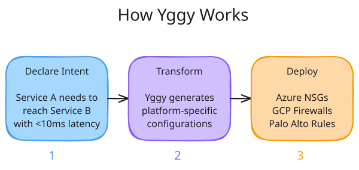
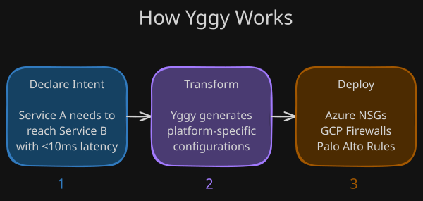

## What is Yggy?

Modern infrastructure spans several clouds, private data centres and edge sites,
each with its own configuration language, protocols and security policy. Keeping
connectivity coherent across that landscape is where most of the effort goes —
and where documentation quietly falls out of step with reality.

Yggy inverts the order. You write an abstract **connectivity descriptor** that
says what should be able to talk to what, and under which constraints. That
descriptor becomes the source of truth, and Yggy renders it into the
platform-specific configuration each provider needs.

!!! quote "The Yggy philosophy"

    **The descriptor IS the documentation. The documentation IS the action.**

---

## What Yggy gives you

-   :material-file-document-outline:{ .lg .middle } **Descriptor-driven model**

    ---

    Network resources, security policy and connectivity intent expressed as
    abstract objects, independent of any single provider.

    [:octicons-arrow-right-24: Core concepts](understanding/concepts.md)

-   :material-cloud-outline:{ .lg .middle } **One model, many platforms**

    ---

    A single vocabulary for Azure VNets and NSGs, Google VPC and firewalls, Palo
    Alto, and OpenShift OVN network policies.

    [:octicons-arrow-right-24: Architecture](system-design/architecture.md)

-   :material-transit-connection-variant:{ .lg .middle } **Intent-based**

    ---

    State the outcome you need — reachability, isolation, availability — and let
    the system work out the configuration that satisfies it.

    [:octicons-arrow-right-24: Why Yggy?](understanding/why-yggy.md)

-   :material-history:{ .lg .middle } **Auditable by construction**

    ---

    Every change is a versioned change to the descriptor, so it is traceable and
    reversible rather than reconstructed after the fact.

    [:octicons-arrow-right-24: Change flow](system-design/change-flow.md)

-   :material-puzzle-outline:{ .lg .middle } **Pluggable providers**

    ---

    New infrastructure types arrive as provider modules. The core model does not
    change when the estate does.

    [:octicons-arrow-right-24: Architecture](system-design/architecture.md)

-   :material-api:{ .lg .middle } **Built to be integrated**

    ---

    A modular Quarkus API designed to sit behind Kratix, Humanitec, Backstage,
    Terraform and similar orchestration tooling.

    [:octicons-arrow-right-24: Architecture](system-design/architecture.md)

---

## How it fits together

The descriptor is submitted, validated against the model, resolved against the
infrastructure it targets, and then translated per provider. [Change
flow](system-design/change-flow.md) follows a single change through each of those
stages.

---

## Principles

1. **Declarative over imperative** — describe *what* you want, not *how* to
   configure it.
2. **Infrastructure independence** — one descriptor is designed to hold across
   Azure, GCP, Palo Alto and OVN.
3. **Single source of truth** — the descriptor stays current because it *is* the
   configuration.
4. **Full auditability** — every change is versioned, traceable and
   rollback-ready.
5. **Pluggable architecture** — add providers without touching the core.

---

## Where to go next

-   :material-lightbulb-outline:{ .lg .middle } **Understanding Yggy**

    ---

    [Why Yggy?](understanding/why-yggy.md) — the problem, and the case for
    declaring connectivity.

    [Core concepts](understanding/concepts.md) — descriptors, intent, topology.

-   :material-cube-outline:{ .lg .middle } **Model objects**

    ---

    [Infrastructure model v1](understanding/model/infrastructure-model-v1.md) —
    targets, landing zones, zones, subnets.

    [Infrastructure model v2](understanding/model/infrastructure-model-v2.md) —
    the domain and perimeter model being introduced.

    [Application model v1](understanding/model/application-model-v1.md) —
    components, dependencies, services.

-   :material-cog-outline:{ .lg .middle } **System design**

    ---

    [Architecture](system-design/architecture.md) — services, storage and
    integration points.

    [Change flow](system-design/change-flow.md) — from submission to deployed
    configuration.

!!! info "What this release contains"

    These pages describe the architecture Yggy is built towards. The published
    code is the v1 codebase in
    [`aud/`](https://github.com/AmadeusITGroup/Yggy/tree/main/aud): the model and
    data libraries, **one** provider integration (Azure network security groups),
    and two Quarkus services. No orchestrator integrations ship yet. See the
    scope note on [Architecture](system-design/architecture.md) for detail.

## Start with the problem

Ten minutes on why declarative connectivity is worth the change of habit is the
fastest way to judge whether Yggy fits your estate.

  <a class="yggy-btn yggy-btn--primary" href="understanding/why-yggy/">Read Why Yggy?</a>
  <a class="yggy-btn yggy-btn--ghost" href="https://github.com/AmadeusITGroup/Yggy">Browse the code</a>

