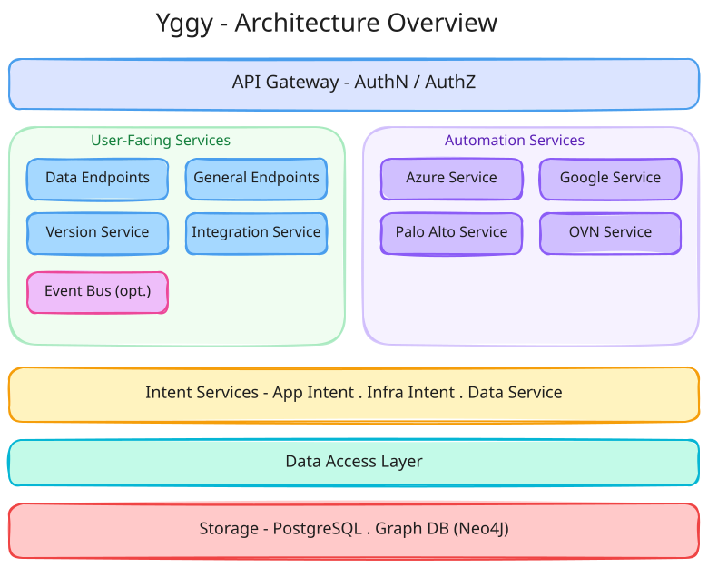
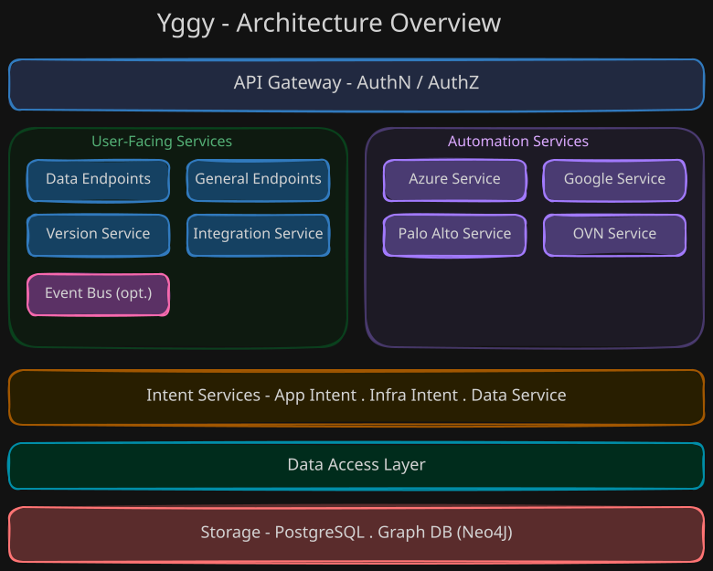
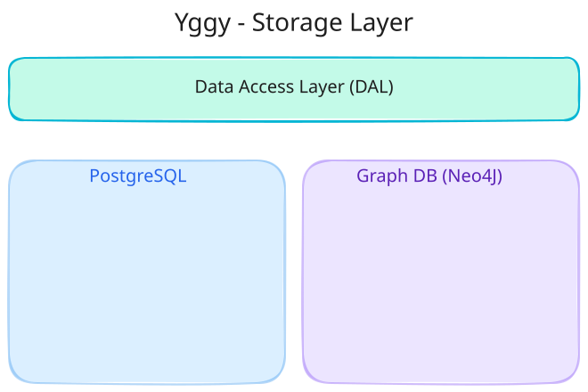
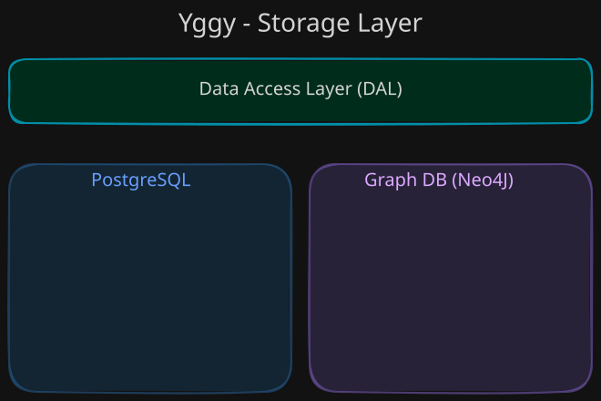

# Architecture

This document describes the Yggy system architecture — its layered design, service components, storage model, and integration points.

!!! info "Target architecture, not the shipped scope"

    This page describes the architecture Yggy is built towards. This release
    publishes the v1 codebase in [`aud/`](https://github.com/AmadeusITGroup/Yggy/tree/main/aud):
    the model and data libraries, one provider integration (Azure network
    security groups), and two Quarkus services — the HTTP API and the
    connectivity engine. Other components described below are internal,
    in development, or planned.

!!! tip "Prerequisites"

    Read [Core Concepts](../understanding/concepts.md) first to understand descriptors, intent, and topology.

## High-Level Overview

Yggy follows a **microservice architecture** built with [Quarkus](https://quarkus.io/), organized in layers:

??? info "Excalidraw Source"

    [:material-download: Download the Architecture Overview diagram (Excalidraw)](../assets/diagrams/system-design/architecture-overview.excalidraw)

The system is structured in five primary layers:

1. **API Gateway** — Authentication, authorization, and routing
2. **Service Layer** — User-facing and automation microservices
3. **Intent Layer** — App and infra intent processing with graph computation
4. **Data Access Layer** — Abstraction over storage queries
5. **Storage Layer** — PostgreSQL for data, graph database for topology and intent

## API Gateway & AuthN/AuthZ

All requests enter through the **API Gateway**, which handles:

- **Authentication** — Verifying the identity of callers
- **Authorization** — Enforcing role-based access control
- **Routing** — Directing requests to the appropriate micro-service

The gateway provides a single entry point for all consumers: SRE teams, automation pipelines, CLI tools, and third-party integrations.

## User-Facing Services

These services expose the core API for human and programmatic consumers:

### Data Endpoints

Provides CRUD operations for descriptors, infrastructure objects, and connectivity data. This is the primary interface for reading and writing Yggy's data model.

### General Endpoints

Exposes utility and administrative operations — health checks, metadata, and system information.

### Version Service

Manages the **versioning lifecycle** of descriptors:

- Creating new versions
- Sealing (finalizing) versions
- Querying version history
- Rollback support

Every change in Yggy produces a new version, providing full auditability and the ability to roll back to any previous state.

### Integration Service

Orchestrates the **change flow** — receiving changes, validating them, running the transformation pipeline, and coordinating deployment. See [Change Flow](change-flow.md) for the full process.

## Automation Services

These services translate Yggy's abstract model into **platform-specific configurations**:

### Provider Services

| Service | Responsibility |
|---------|---------------|
| **Azure Service** | Generates Azure VNet, Subnet, NSG, and Hub/Spoke configurations |
| **Google Service** | Generates Google Cloud VPC and Firewall rule configurations |
| **Palo Alto Service** | Generates Palo Alto firewall security policies |
| **OVN Service** | Generates OpenShift OVN Network Policies |

Each provider service is a **pluggable module**. New providers can be added without modifying the core system — just implement the provider interface and register it.

## Intent Services

### App Intent Service

Processes **application-level connectivity intent** — what applications need from the network. Generates the App Intent Graph that captures service-to-service connectivity requirements.

### Infra Intent Service

Processes **infrastructure-level connectivity intent** — what the network team wants to enforce. Generates the Infra Intent Graph that captures topology constraints, security boundaries, and routing policies.

The intent graphs are combined during the transformation pipeline to produce the final connectivity configuration.

## Data Access Layer

The **Data Access Layer (DAL)** provides an abstraction over SQL queries, decoupling the service layer from the storage implementation. This design choice means:

- Changing storage technology has minimal impact on services
- Query optimization is centralized
- Data access patterns are consistent across services

## Storage Layer

??? info "Excalidraw Source"

    [:material-download: Download the Storage Layer diagram (Excalidraw)](../assets/diagrams/system-design/storage-layer.excalidraw)

### PostgreSQL

The primary data store for Yggy's **data model**:

- Descriptor definitions and versions
- Infrastructure configuration data
- Security policies and governance rules
- Deployment tracking and operation history

### Graph Database

!!! warning "Under Discussion"

    Neo4J is the leading candidate for the graph database.

A graph database stores the **intent and topology graphs**:

- Connectivity relationships between resources
- Network topology and path analysis
- Intent graph for application and infrastructure connectivity
- Enables efficient graph traversal queries for connectivity validation

## Event Bus (Optional)

An optional **event bus** enables asynchronous communication between services:

- Decouples services for better scalability
- Enables event-driven automation workflows
- Supports notification and webhook patterns

## Integration Points

Yggy is designed to integrate with the broader infrastructure automation ecosystem:

| Tool | Integration |
|------|-------------|
| **Kratix** | Platform-as-a-Service orchestration |
| **Humanitec** | Internal Developer Platform integration |
| **Backstage** | Developer portal and service catalog |
| **Terraform** | Infrastructure-as-Code deployment |
| **Jenkins** | CI/CD pipeline integration |
| **Bitbucket** | Source control and PR-based workflows |
| **Kubernetes Operator** | Kubernetes-native deployment and reconciliation |
| **Yggy CLI** | Command-line interface for direct interaction |
| **Yggy Viewer** | Web-based visualization of connectivity and topology |

## Further Reading

- [Why Yggy?](../understanding/why-yggy.md) — The problem Yggy solves
- [Core Concepts](../understanding/concepts.md) — Descriptors, intent, and declarative connectivity
- [Change Flow](change-flow.md) — How changes move through the pipeline
- [Wiki Home](../index.md) — Back to the wiki
