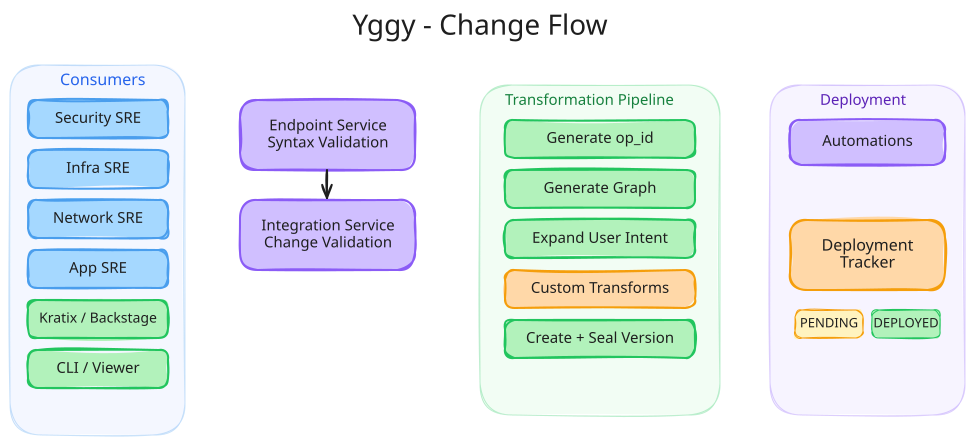
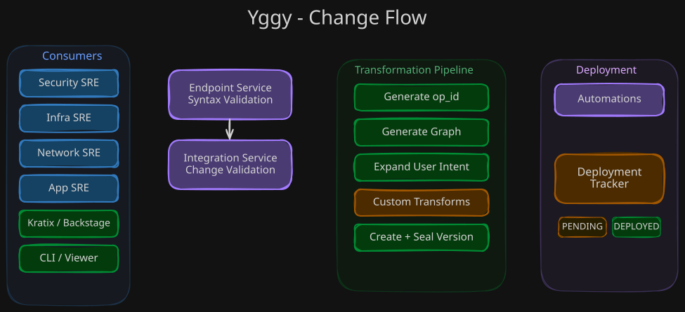

# Change Flow

This document describes how changes flow through the Yggy system — from initial request to deployed configuration.

!!! info "Target flow, not the shipped scope"

    This describes the end-to-end flow Yggy is built towards. Not every stage
    below corresponds to code in this release; see the note on
    [Architecture](architecture.md) for what is published.

## Overview

When a user or automation submits a connectivity change, it passes through a series of stages: validation, transformation, versioning, and deployment tracking. The process is designed to be **asynchronous** and **traceable**, with every change assigned an `operation_id` that can be queried for status at any point.

<div class="only-light" markdown>

</div>
<div class="only-dark" markdown>

</div>

??? info "Excalidraw Source"

    [:material-download: Download the Change Flow diagram (Excalidraw)](../assets/diagrams/system-design/change-flow.excalidraw)

## Flow Stages

### 1. Endpoint Service — Entry Point

All changes enter through the **Endpoint Service**, which provides the API surface for:

- Direct API calls from SRE teams
- Automation pipelines (Jenkins, Terraform, Robot)
- CLI tool submissions
- Kubernetes Operator reconciliation
- PR-based workflows from Bitbucket

The Endpoint Service performs **syntax validation** — ensuring the submitted descriptor is well-formed and conforms to the expected schema. Invalid requests are rejected immediately with a `400` response.

### 2. Integration Service — Change Validation

Valid requests are forwarded to the **Integration Service**, which performs deeper **change validation**:

- Checks that the change is consistent with existing descriptors
- Validates against governance policies and security guardrails
- Ensures no conflicting changes are in progress
- Verifies that the referenced infrastructure exists in the topology

If validation fails, the request is rejected with a `400` response and detailed error information.

### 3. Transformation Pipeline

Once validated, the change enters the **Transformation Pipeline** — the core of Yggy's declarative connectivity model:

#### Generate Operation ID

An `operation_id` is generated to track this change through the entire lifecycle. This ID is returned to the caller for asynchronous status queries.

#### Generate Connectivity/Topology Graph

The system computes the updated connectivity and topology graphs based on the change.

#### Expand User Intent

User-level intent declarations are expanded into concrete connectivity requirements. For example, "Service A must reach Service B" becomes specific network rules across the relevant infrastructure components.

#### Specific Transformations

The pipeline supports **injection of organization-specific transformations**. This is where company-dependent logic can customize the standard transformation process without modifying the core system.

#### Create New Version

A new version of the affected descriptors is created, capturing the full state after the change.

#### Seal Version

The version is **sealed** — finalized and immutable. Sealed versions form the audit trail and can be used for rollback.

### 4. Deployment

The sealed version is **published** to the automation layer:

- Provider-specific configurations are generated (Azure, Google, Palo Alto, OVN)
- Configurations are deployed to target infrastructure via the respective automation services
- The **Deployment Tracker** monitors the rollout

### 5. Deployment Tracker — Status Tracking

The **Deployment Tracker** maintains the status of each operation:

| Status | Meaning |
|--------|---------|
| `PENDING` | Change has been accepted and is queued for deployment |
| `IN PROGRESS` | Deployment is actively being applied to infrastructure |
| `DEPLOYED` | Change has been successfully applied to all target infrastructure |

Callers can query the status at any time using the `operation_id`:

```
GET /operations/{operation_id}/status
```

## Async Integration

The change flow is inherently **asynchronous**. After submitting a change, the caller receives:

1. An immediate response with the `operation_id`
2. The ability to **poll** for status updates
3. Optional **notifications** when status transitions occur (via webhooks or event bus)

This design allows Yggy to handle long-running deployments across multiple infrastructure components without blocking the caller.

## Consumers

The change flow supports multiple consumer types:

| Consumer | Interaction Pattern |
|----------|-------------------|
| **Security SRE** | Defines security policies and guardrails |
| **Infra SRE** | Manages infrastructure configurations |
| **Network SRE** | Handles network topology and routing |
| **Application SRE** | Declares application connectivity intent |
| **Automation (Robot)** | Automated end-to-end deployments |
| **Kratix / Humanitec / Backstage** | Platform orchestration integration |
| **Yggy CLI** | Command-line operations |
| **Yggy Viewer** | Visual monitoring of change status |

## Further Reading

- [Why Yggy?](../understanding/why-yggy.md) — The problem Yggy solves
- [Core Concepts](../understanding/concepts.md) — Descriptors, intent, and declarative connectivity
- [Architecture](architecture.md) — System architecture and service components
- [Wiki Home](../index.md) — Back to the wiki

