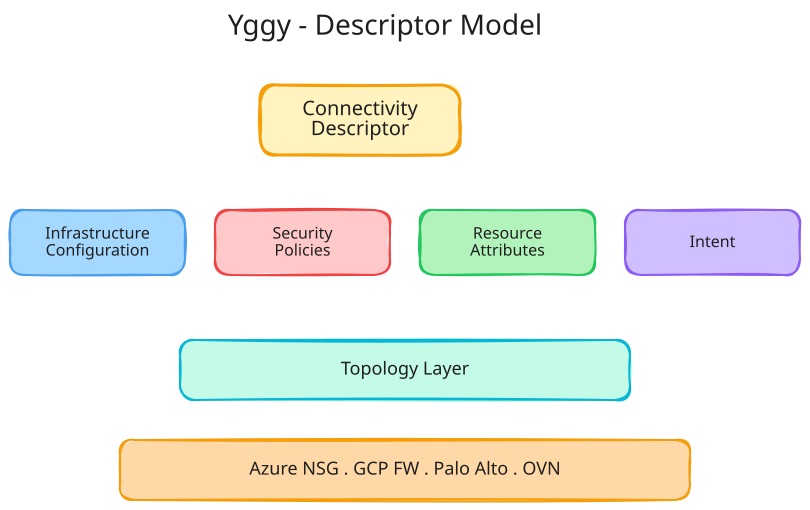
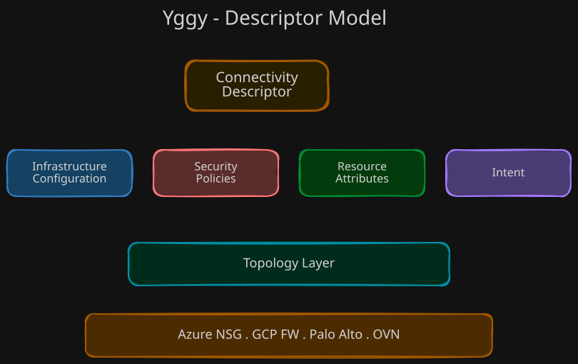

# Core Concepts

This document covers the foundational concepts behind Yggy — the building blocks that make declarative, infrastructure-independent connectivity management possible.

!!! tip "Tip"

    If you haven't read [Why Yggy?](why-yggy.md) yet, start there for the problem context and motivation.

## Descriptors

A **descriptor** is an abstract representation of a network resource, configuration, policy, or connectivity intent. Descriptors are the fundamental unit of Yggy's model. They capture *what* connectivity should look like without prescribing *how* it is implemented on any specific platform.

Using a Kubernetes-like declarative syntax, descriptors represent infrastructure and then link it with application requirements and connectivity intent.

??? info "Excalidraw Source"

    [:material-download: Download the Descriptor Model diagram (Excalidraw)](../assets/diagrams/overview/descriptor-model.excalidraw)

Descriptors include information across four categories:

### Infrastructure Configuration

Describes the physical and logical network topology:

- IP address ranges and subnets
- VLANs and network segments
- Routing policies and tables
- Virtual networks and their relationships

### Security Policies

Captures security requirements and guardrails:

- Connectivity guardrails and boundaries
- Access control configurations (NSGs, firewall rules)
- VPN settings and encryption requirements
- Security zone definitions

### Resource Attributes

Defines the compute, storage, and network resources:

- Compute instances and their network interfaces
- Storage volumes and access paths
- Network interfaces and bindings
- Service endpoints

### Intent

Expresses desired outcomes rather than specific configurations:

- Performance targets (throughput, latency)
- Availability requirements (redundancy, failover)
- Response time objectives
- Quality of service parameters

## Topology

Yggy maintains a model of the underlying **network and system topology** — the actual infrastructure landscape across all environments. Descriptors are mapped onto this topology to form the **unified abstract model**.

The topology captures:

- **Sites and locations** — data centers, cloud regions, edge locations
- **Network segments** — VNets, VPCs, subnets, VLANs
- **Interconnections** — WAN links, VPN tunnels, peerings, Direct Connect
- **Security boundaries** — landing zones, security zones, implementation zones

By combining descriptors with topology, Yggy can reason about connectivity end-to-end, across platforms and providers.

## Intent

Yggy distinguishes between two types of intent:

### Application Intent

What applications need from the network:

- "Service A must reach Service B with less than 10ms latency"
- "This workload requires encrypted connectivity to the database tier"
- "These microservices need mutual connectivity within their namespace"

Application intent is processed by the **App Intent Service**, which generates the App Intent Graph — a graph structure capturing service-to-service connectivity requirements.

### Infrastructure Intent

What the infrastructure team wants to enforce:

- "All traffic between zones must traverse the firewall"
- "Production and test workloads must be segregated"
- "Egress traffic must go through the network service edge"

Infrastructure intent is processed by the **Infra Intent Service**, which generates the Infra Intent Graph — a graph structure capturing topology constraints, security boundaries, and routing policies.

### The Intent Graph

The **Intent Graph** combines both application and infrastructure intent into a unified graph. During the transformation pipeline, this graph is used to:

1. Validate that application requirements don't violate infrastructure policies
2. Compute the optimal connectivity paths across the topology
3. Generate platform-specific configurations that satisfy both types of intent

## Declarative Connectivity

Traditional network management follows a cycle: plan → implement → document. Documentation lags behind reality, and drift accumulates over time.

Yggy flips this paradigm:

!!! quote "The Yggy Philosophy"

    **The descriptor IS the documentation. The documentation IS the action.**

Instead of configuring infrastructure and then documenting what was done, you declare your connectivity intent in a descriptor. Yggy's transformation pipeline reads these declarations and produces platform-specific configurations that are deployed to the target infrastructure.

This approach provides:

- **Single source of truth** — The descriptor is always up to date because it *is* the configuration.
- **Auditability** — Every change is versioned and traceable through the system.
- **Consistency** — The same descriptor produces consistent results across environments.
- **Testability** — Descriptors can be validated before deployment.
- **Distributed control** — Different teams manage their own descriptors, while governance is centralized.

## Versioning

Every change in Yggy produces a **new version** of the affected descriptors. Versions follow a strict lifecycle:

1. **Created** — A new version is initialized with the proposed changes
2. **Sealed** — The version is finalized and becomes immutable
3. **Published** — The sealed version is deployed to target infrastructure

Sealed versions form the **audit trail** and enable **rollback** to any previous state. This guarantees full traceability of every connectivity change across the entire infrastructure.

## Infrastructure Types Managed

The provider model targets a growing set of infrastructure platforms:

| Provider | Resources Managed | In this release |
|----------|-------------------|-----------------|
| **Azure** | Virtual Networks (VNets), Subnets, Network Security Groups (NSGs), Hub/Spoke topologies | Yes — network security groups |
| **Google Cloud** | Virtual Private Clouds (VPCs), Firewall rules | No |
| **Palo Alto** | Firewall configurations, security policies | No |
| **OpenShift** | OVN (Open Virtual Network) Network Policies | No |

!!! info "One provider integration ships today"

    This release publishes the Azure network security group integration
    (`aud/libraries/lib-azure-nsg`). The other rows describe where the provider
    model is going; there is no code for them in this repository. See the scope
    note on [Architecture](../system-design/architecture.md).

The modular architecture allows new providers to be added without modifying the core system. See [Architecture](../system-design/architecture.md) for details on the provider model.

## Further Reading

- [Why Yggy?](why-yggy.md) — The problem and the approach
- [Architecture](../system-design/architecture.md) — How the system is built
- [Change Flow](../system-design/change-flow.md) — How changes move through the pipeline
- [Wiki Home](../index.md) — Back to the wiki
