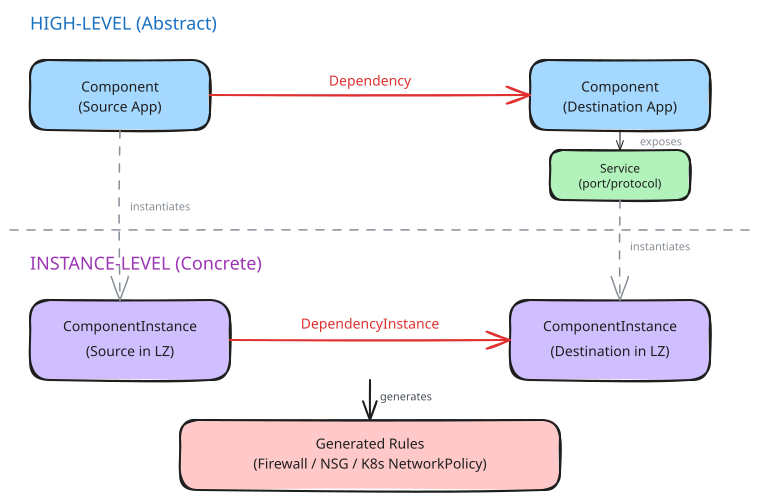
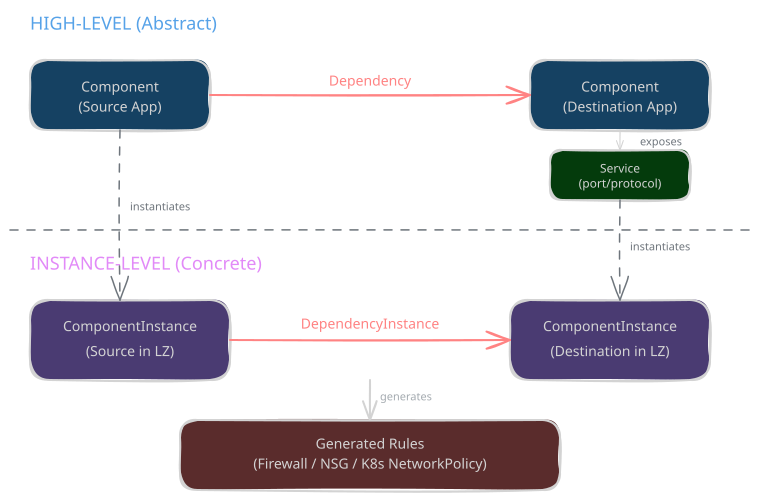

# Application Model v1

This page describes the application-level objects in Yggy that express **connectivity intent** — what needs to talk to what, on which port, using which protocol. While the [Infrastructure Model](infrastructure-model-v1.md) describes *where* things are, the Application Model describes *how* they connect.

!!! tip "Tip"

    Read the [Infrastructure Model v1](infrastructure-model-v1.md) first to understand Targets, Landing Zones, Zone Instances, and Subnet Instances — the Application Model builds on top of these.

## Overview

The application model is split into two layers:

- **High-level (abstract)**: Defines *what* your application is and *what* it connects to, independent of deployment location.
- **Instance-level (concrete)**: Defines *where* each deployment lives and *which specific instances* connect to each other.

<div class="only-light" markdown>

</div>
<div class="only-dark" markdown>

</div>

??? info "Excalidraw Source"

    [:material-download: Download the Application Model diagram (Excalidraw)](../../assets/diagrams/application-model/application-model-v1.excalidraw)

| Layer | Object | Purpose |
|-------|--------|---------|
| High-level | **Component** | Your application or system (abstract) |
| High-level | **Service** | A port/protocol exposed by a component |
| High-level | **Dependency** | A relationship: "Component A needs Component B" |
| Instance | **ComponentInstance** | A concrete deployment of a component in a specific landing zone |
| Instance | **DependencyInstance** | A concrete connectivity rule between two component instances |

---

## Component

A **Component** is the abstract representation of an application, middleware, or system. It is independent of where or how many times it is deployed.

Examples: `MyWebApp`, `MyOracleDB`, `Splunk`, `Redis`.

### Key Attributes

| Attribute | Description |
|-----------|-------------|
| `name` | Unique identifier for the component |
| `is_hosted` | Whether this component runs inside a PaaS (container) |
| `is_hosting` | Whether this component hosts other components (e.g., a PaaS platform) |
| `parents` | List of parent components (interface inheritance) |
| `security_zones` | Allowed security zone types (e.g., `app`, `dmz`) |

### YAML Example

```yaml
---
api_version: v1
kind: Component
metadata:
  name: MyWebApp
  scope: MyProject
  comment: Web application backend
spec:
  is_hosted: true
  security_zones:
    - app
  parents:
    - SPLUNK_Interface
```

---

## Service

A **Service** defines a network endpoint exposed by a component — specifically a **port** and **protocol** combination that other components can target.

A component can expose multiple services (e.g., an HTTP API on port 8080 and a metrics endpoint on port 9090).

### Key Attributes

| Attribute | Description |
|-----------|-------------|
| `name` | Descriptive name for the service |
| `component` | The component that provides this service |
| `ports` | Port number(s) or range (e.g., `8080`, `1433`) |
| `protocol` | Transport protocol: `Tcp`, `Udp`, or `Icmp` |
| `is_encrypted` | Whether traffic is encrypted |

### YAML Example

```yaml
---
api_version: v1
kind: Service
metadata:
  name: MyWebApp API (tcp/8080)
  scope: MyProject
spec:
  component: MyWebApp
  ports:
    - '8080'
  protocol: Tcp
  is_encrypted: true
---
api_version: v1
kind: Service
metadata:
  name: MyOracleDB listener (tcp/1521)
  scope: MyProject
spec:
  component: MyOracleDB
  ports:
    - '1521'
  protocol: Tcp
  is_encrypted: false
```

---

## Dependency

A **Dependency** declares that one component (the source) needs to communicate with another component (the destination). It is a high-level, location-independent statement of intent.

### Key Attributes

| Attribute | Description |
|-----------|-------------|
| `name` | Descriptive name (e.g., `MyWebApp to MyOracleDB`) |
| `source_component` | The component that initiates the connection |
| `target_component` | The component that receives the connection |
| `security_justification` | Reason for this connectivity (for governance) |

### YAML Example

```yaml
---
api_version: v1
kind: Dependency
metadata:
  name: MyWebApp to MyOracleDB
  scope: MyProject
spec:
  source_component: MyWebApp
  target_component: MyOracleDB
  security_justification: Backend needs database access for user data
```

---

## ComponentInstance

A **ComponentInstance** is the concrete deployment of a component in a specific landing zone. This is where the application model meets the infrastructure model — a component instance has a physical location (landing zone, subnet, zone).

There are two main types:

### PaaS-hosted (Container)

A container running in a Kubernetes-based PaaS platform. Its network location is derived from the hosting PaaS's zone instances.

| Attribute | Description |
|-----------|-------------|
| `name` | Instance identifier |
| `component` | The parent component |
| `landingzone` | The landing zone where the PaaS resides |
| `application_phase` | Lifecycle phase (e.g., TST, PRD) |
| `zone_type` | Security zone (e.g., `app`) |
| `namespace` | Kubernetes namespace |
| `in_zone_instance` | Optional: restricts inbound to a specific zone instance |
| `out_zone_instance` | Optional: restricts outbound to a specific zone instance |

### IaaS-hosted (VM / Bare-metal)

A traditional virtual machine or physical server. Its network location is explicitly specified through subnet instances.

| Attribute | Description |
|-----------|-------------|
| `name` | Instance identifier |
| `component` | The parent component |
| `landingzone` | The landing zone where the VM resides |
| `application_phase` | Lifecycle phase (e.g., TST, PRD) |
| `zone_type` | Security zone (e.g., `app`) |
| `in_zone_instance` | Zone instance for inbound traffic |
| `out_zone_instance` | Zone instance for outbound traffic |

### YAML Examples

=== "PaaS Container"

    ```yaml
    ---
    api_version: v1
    kind: ComponentInstance
    metadata:
      name: MyWebApp in TST
      scope: MyProject
      landingzone: test-west-europe-integration-01
    spec:
      component: MyWebApp
      application_phase: TST
      zone_type: app
      namespace: myproject-ns
    ```

=== "IaaS VM"

    ```yaml
    ---
    api_version: v1
    kind: ComponentInstance
    metadata:
      name: MyOracleDB in TST
      scope: MyProject
      landingzone: test-west-europe-integration-01
    spec:
      component: MyOracleDB
      application_phase: TST
      zone_type: app
      in_zone_instance: app1-db
      out_zone_instance: app1-db
    ```

---

## DependencyInstance

A **DependencyInstance** is the concrete connectivity rule between two specific component instances, referencing a specific service. This is the object that ultimately generates firewall rules, NSG rules, and Kubernetes network policies.

### Key Attributes

| Attribute | Description |
|-----------|-------------|
| `name` | Descriptive name |
| `landingzone` | Landing zone context for this dependency instance |
| `dependency` | Reference to the parent Dependency |
| `source_component_instance` | The source component instance |
| `target_component_instance` | The target component instance |
| `target_services` | List of services to open (port/protocol) |

### YAML Example

```yaml
---
api_version: v1
kind: DependencyInstance
metadata:
  name: MyWebApp TST to MyOracleDB TST
  scope: MyProject
  landingzone: test-west-europe-integration-01
spec:
  dependency: MyWebApp to MyOracleDB
  source_component_instance: MyWebApp in TST
  target_component_instance: MyOracleDB in TST
  target_services:
    - "MyOracleDB listener (tcp/1521)"
```

---

## End-to-End Example

Let's walk through a complete scenario with two use cases:

1. **A PaaS web application connecting to an IaaS database**
2. **Two PaaS applications communicating with each other**

All resources are in landing zone `test-west-europe-integration-01` (Target: `test-west-europe`).

### Scenario Setup

```yaml
# =============================================================
# HIGH-LEVEL: Components, Services, Dependencies
# =============================================================

# --- Components ---
---
api_version: v1
kind: Component
metadata:
  name: MyWebApp
  scope: MyProject
  comment: REST API backend (PaaS container)
spec:
  is_hosted: true
  security_zones:
    - app
---
api_version: v1
kind: Component
metadata:
  name: MyOracleDB
  scope: MyProject
  comment: Oracle database (IaaS VM)
spec:
  is_hosted: false
  security_zones:
    - app
---
api_version: v1
kind: Component
metadata:
  name: MyFrontend
  scope: MyProject
  comment: Frontend BFF service (PaaS container)
spec:
  is_hosted: true
  security_zones:
    - app

# --- Services ---
---
api_version: v1
kind: Service
metadata:
  name: MyWebApp API (tcp/8080)
  scope: MyProject
spec:
  component: MyWebApp
  ports:
    - '8080'
  protocol: Tcp
  is_encrypted: true
---
api_version: v1
kind: Service
metadata:
  name: MyOracleDB listener (tcp/1521)
  scope: MyProject
spec:
  component: MyOracleDB
  ports:
    - '1521'
  protocol: Tcp

# --- Dependencies ---
---
api_version: v1
kind: Dependency
metadata:
  name: MyWebApp to MyOracleDB
  scope: MyProject
spec:
  source_component: MyWebApp
  target_component: MyOracleDB
  security_justification: Backend needs DB access
---
api_version: v1
kind: Dependency
metadata:
  name: MyFrontend to MyWebApp
  scope: MyProject
spec:
  source_component: MyFrontend
  target_component: MyWebApp
  security_justification: Frontend BFF calls backend API
```

### Instance-Level Deployment

```yaml
# =============================================================
# INSTANCE-LEVEL: ComponentInstances, DependencyInstances
# =============================================================

# --- Component Instances ---
---
api_version: v1
kind: ComponentInstance
metadata:
  name: MyWebApp in TST
  scope: MyProject
  landingzone: test-west-europe-integration-01
spec:
  component: MyWebApp
  application_phase: TST
  zone_type: app
  namespace: myproject-ns
---
api_version: v1
kind: ComponentInstance
metadata:
  name: MyOracleDB in TST
  scope: MyProject
  landingzone: test-west-europe-integration-01
spec:
  component: MyOracleDB
  application_phase: TST
  zone_type: app
  in_zone_instance: app1-db
  out_zone_instance: app1-db
---
api_version: v1
kind: ComponentInstance
metadata:
  name: MyFrontend in TST
  scope: MyProject
  landingzone: test-west-europe-integration-01
spec:
  component: MyFrontend
  application_phase: TST
  zone_type: app
  namespace: myproject-ns

# --- Dependency Instances ---
---
api_version: v1
kind: DependencyInstance
metadata:
  name: MyWebApp TST to MyOracleDB TST
  scope: MyProject
  landingzone: test-west-europe-integration-01
spec:
  dependency: MyWebApp to MyOracleDB
  source_component_instance: MyWebApp in TST
  target_component_instance: MyOracleDB in TST
  target_services:
    - "MyOracleDB listener (tcp/1521)"
---
api_version: v1
kind: DependencyInstance
metadata:
  name: MyFrontend TST to MyWebApp TST
  scope: MyProject
  landingzone: test-west-europe-integration-01
spec:
  dependency: MyFrontend to MyWebApp
  source_component_instance: MyFrontend in TST
  target_component_instance: MyWebApp in TST
  target_services:
    - "MyWebApp API (tcp/8080)"
```

---

## Generated Security Rules

From the dependency instances defined above, Yggy generates security rules that are deployed to three enforcement layers. Below are illustrative examples of what gets generated.

### Firewall Rules

Firewall rules control traffic between zones at the perimeter level. They are generated as connectivity rules and pushed to Azure Firewall or PaloAlto via automation.

For **MyWebApp TST → MyOracleDB TST** (PaaS to IaaS, TCP/1521):

```json
{
  "name": "ar-from-mywebapp_in_tst-to-myoracledb_in_tst-tcp_1521",
  "dependencyInstanceName": "MyWebApp TST to MyOracleDB TST",
  "scope": "MyProject",
  "protocol": "Tcp",
  "ports": ["1521"],
  "srcObjectGroup": {
    "name": "ag-mywebapp_in_tst",
    "type": "AddressGroup",
    "zoneType": "app",
    "endpoints": [
      { "type": "cidr", "value": "172.16.0.0/24", "description": "app1-paas-out" }
    ]
  },
  "dstObjectGroup": {
    "name": "ag-myoracledb_in_tst",
    "type": "AddressGroup",
    "zoneType": "app",
    "endpoints": [
      { "type": "cidr", "value": "172.16.1.0/27", "description": "app1-db" }
    ]
  }
}
```

### NSG Rules (Network Security Group)

NSG rules filter traffic at the subnet level within a landing zone. They are generated per subnet and direction.

Yggy produces a JSON payload consumed by the NSG automation to apply rules on the target subnet's NSG:

```json
{
  "landingZone": "test-west-europe-integration-01",
  "subnetInstance": "app1-db",
  "rules": [
    {
      "name": "nsg-allow-mywebapp_tst-to-myoracledb_tst-tcp_1521-inbound",
      "priority": 1200,
      "direction": "Inbound",
      "access": "Allow",
      "protocol": "Tcp",
      "sourceAddressPrefix": "172.16.0.0/24",
      "destinationAddressPrefix": "172.16.1.0/27",
      "destinationPortRange": "1521",
      "dependencyInstanceName": "MyWebApp TST to MyOracleDB TST",
      "scope": "MyProject"
    }
  ]
}
```

And the corresponding outbound rule on the source subnet's NSG:

```json
{
  "landingZone": "test-west-europe-integration-01",
  "subnetInstance": "app1-paas-out",
  "rules": [
    {
      "name": "nsg-allow-mywebapp_tst-to-myoracledb_tst-tcp_1521-outbound",
      "priority": 1200,
      "direction": "Outbound",
      "access": "Allow",
      "protocol": "Tcp",
      "sourceAddressPrefix": "172.16.0.0/24",
      "destinationAddressPrefix": "172.16.1.0/27",
      "destinationPortRange": "1521",
      "dependencyInstanceName": "MyWebApp TST to MyOracleDB TST",
      "scope": "MyProject"
    }
  ]
}
```

This results in the following NSG rules being applied:

For the **destination subnet** `app1-db` (inbound):

```
Priority  Direction  Source CIDR      Dest CIDR       Port  Protocol  Action
1200      Inbound    172.16.0.0/24    172.16.1.0/27   1521  Tcp       Allow
```

For the **source subnet** `app1-paas-out` (outbound):

```
Priority  Direction  Source CIDR      Dest CIDR       Port  Protocol  Action
1200      Outbound   172.16.0.0/24    172.16.1.0/27   1521  Tcp       Allow
```

### Kubernetes Network Policies

For traffic **between two PaaS containers** in the same cluster (MyFrontend → MyWebApp on port 8080), Yggy produces a JSON payload consumed by the Kubernetes operator to generate NetworkPolicies:

```json
{
  "landingZone": "test-west-europe-integration-01",
  "namespace": "myproject-ns",
  "policies": [
    {
      "name": "allow-myfrontend-to-mywebapp",
      "dependencyInstanceName": "MyFrontend TST to MyWebApp TST",
      "scope": "MyProject",
      "direction": "Ingress",
      "targetPodSelector": {
        "matchLabels": { "app": "mywebapp" }
      },
      "peers": [
        {
          "namespaceSelector": { "matchLabels": { "name": "myproject-ns" } },
          "podSelector": { "matchLabels": { "app": "myfrontend" } }
        }
      ],
      "ports": [
        { "protocol": "TCP", "port": 8080 }
      ]
    }
  ]
}
```

The operator reconciles this into the following Kubernetes NetworkPolicy:

```yaml
apiVersion: networking.k8s.io/v1
kind: NetworkPolicy
metadata:
  name: allow-myfrontend-to-mywebapp
  namespace: myproject-ns
spec:
  podSelector:
    matchLabels:
      app: mywebapp
  policyTypes:
    - Ingress
  ingress:
    - from:
        - namespaceSelector:
            matchLabels:
              name: myproject-ns
          podSelector:
            matchLabels:
              app: myfrontend
      ports:
        - protocol: TCP
          port: 8080
```

!!! note "Enforcement Layers"

    The three rule types are not mutually exclusive. A connection from a PaaS container to an IaaS VM will generate:

    - A **Kubernetes egress policy** on the source pod
    - An **NSG outbound rule** on the PaaS subnet
    - A **Firewall rule** if zones cross a firewall boundary
    - An **NSG inbound rule** on the destination subnet

    Yggy determines which layers apply based on the source and destination locations in the infrastructure model.

---

## Summary

| Step | What You Define | What Gets Generated |
|------|----------------|---------------------|
| 1. Component | Your application identity | — |
| 2. Service | Ports & protocol you expose | — |
| 3. Dependency | Who talks to whom (abstract) | — |
| 4. ComponentInstance | Where your app is deployed | — |
| 5. DependencyInstance | Concrete connectivity link | Firewall rules, NSG rules, K8s NetworkPolicies |

The application model separates **intent** (what you need) from **enforcement** (how it's implemented), letting teams declare their connectivity requirements without needing to understand the underlying network security mechanisms.
