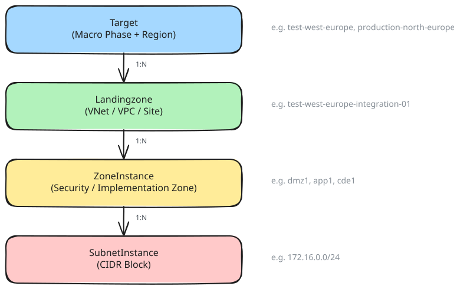
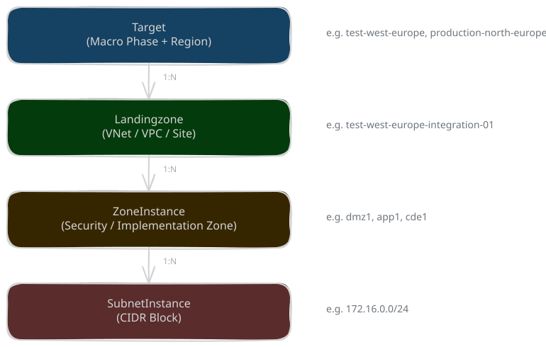

# Infrastructure Model v1

This page describes the core infrastructure objects that form the physical and logical network topology in Yggy. These objects are organized in a strict hierarchy, from broad geographic/phase groupings down to individual network subnets.

!!! tip "Tip"

    If you're new to Yggy, read [Core Concepts](../concepts.md) first to understand descriptors and how the model fits into the bigger picture.

## Hierarchy Overview

The infrastructure model follows a top-down hierarchy:

<div class="only-light" markdown>

</div>
<div class="only-dark" markdown>

</div>

??? info "Excalidraw Source"

    [:material-download: Download the Infrastructure Model diagram (Excalidraw)](../../assets/diagrams/infrastructure-model/infrastructure-model-v1.excalidraw)

Each level refines the scope of the network environment:

| Level | Object | Purpose |
|-------|--------|---------|
| 1 | **Target** | Groups landing zones by macro phase + region |
| 2 | **Landingzone** | A network environment (VNet, VPC, legacy site) |
| 3 | **ZoneInstance** | A security/implementation zone within a landing zone |
| 4 | **SubnetInstance** | A specific CIDR block within a zone instance |

---

## Target

A **Target** is the highest-level grouping in the infrastructure model. It represents the combination of a **Macro Phase** (e.g., RND, TST, PRD) and a **Region** (e.g., West Europe, North Europe), along with metadata about the cloud provider and continent.

All Landing Zones and hubs belonging to the same macro phase and region are grouped under a single Target.

### Key Attributes

| Attribute | Description |
|-----------|-------------|
| `name` | Identifier for the target (e.g., `test-west-europe`, `production-north-europe`) |
| `macro_phase` | The lifecycle phase: RND, TST, PRD, etc. |
| `continent` | Geographic continent (e.g., Europe, Worldwide) |
| `provider` | Cloud provider or On Premise identifier (e.g., Microsoft - Azure, Amazon - AWS) |
| `target_type` | Classification: Regional Hub, Lite Hub, Legacy |

### Examples

| Name | Macro Phase | Provider | Target Type |
|------|-------------|----------|-------------|
| `test-west-europe` | TST | Microsoft - Azure | Regional Hub |
| `production-north-europe` | PRD | Microsoft - Azure | Regional Hub |

---

## Landingzone

A **Landingzone** is a network environment that belongs to a Target. In Azure, it typically corresponds to a Virtual Network (VNet); in AWS, to a VPC; in legacy environments, to a physical site.

A landing zone groups all the zone instances and subnets that exist within that network boundary.

### Key Attributes

| Attribute | Description |
|-----------|-------------|
| `name` | Unique identifier (e.g., `test-west-europe-integration-01`) |
| `target` | The parent Target this landing zone belongs to |
| `region` | Provider region (e.g., West Europe, North Europe) |
| `macro_phase` | Lifecycle phase (inherited from target) |
| `landing_zone_type` | Type classification (see below) |
| `functional_types` | Optional functional labels for automatic instantiation |

### Landing Zone Types

| Type | Description |
|------|-------------|
| Default Azure Spoke | Standard Azure spoke VNet |
| Amazon HUB | AWS hub network |
| Legacy | On-premises |

---

## ZoneInstance

A **ZoneInstance** represents an implementation zone within a landing zone. It defines a security boundary where specific Network security layer rules and firewall policies apply.

Each zone instance is associated with a **zone type** that determines the security classification (e.g., DMZ, application, transit).

### Key Attributes

| Attribute | Description |
|-----------|-------------|
| `name` | Identifier within the landing zone (e.g., `dmz1`, `app1`, `cde1`) |
| `landing_zone` | The parent landing zone |
| `zone_type` | Security zone classification (see below) |

### Zone Types

| Zone Type | Description |
|-----------|-------------|
| `dmz` | Demilitarized zone — public-facing services |
| `app` | Application zone — internal application workloads |
| `cde` | Cardholder Data Environment — PCI-compliant zone |

### Usage with Component Instances (Applicative Intent)

#### IaaS-hosted Component Instances

For IaaS component instances (virtual machines, bare-metal servers), the component instance declares its location using **`in_zone_instance`** and **`out_zone_instance`**, which point to specific zone instances. The security zone is determined implicitly from the zone instance.

In summary, for IaaS:

- **`in_zone_instance`**: The zone instance where inbound traffic is received.
- **`out_zone_instance`**: The zone instance where outbound traffic originates.

#### PaaS-hosted component instances

Containers (PaaS-hosted component instances) reference zone instances to control their inbound and outbound network connectivity:

- **`in_zone_instance`**: Restricts **inbound** traffic to only the CIDRs of the referenced implementation zone. Must correspond to a `D_IN` or `D_INOUT` endpoint of the PaaS.
- **`out_zone_instance`**: Restricts **outbound** traffic to only the CIDRs of the referenced implementation zone. Must correspond to a `D_OUT` or `D_INOUT` endpoint of the PaaS.

When neither is set, the default connectivity applies (all CIDRs of the IN/OUT directions of the PaaS). When both reference the same `D_INOUT` endpoint, both inbound and outbound are limited to that implementation zone's CIDRs.

---

## SubnetInstance

A **SubnetInstance** is the most granular level of the infrastructure model. It represents a specific network subnet (CIDR block) within a zone instance.

Subnets are where component instances are physically or logically located and where IP addresses are assigned.

### Key Attributes

| Attribute | Description |
|-----------|-------------|
| `name` | Identifier (e.g., `dmz1-subnet1`, `dmz1-subnet2`, `app1-subnet1`, `cde1-subnet1`) |
| `landing_zone` | The parent landing zone |
| `zone_instance` | The parent zone instance this subnet belongs to |
| `cidr` | The IP address range (e.g., `172.16.0.0/24`) |


### Relationship to Zone Instances

A zone instance can contain one or more subnet instances. All subnets within a zone instance share the same security zone classification:

```
ZoneInstance (zone_type: dmz)
├── SubnetInstance (cidr: 172.16.0.0/24)
├── SubnetInstance (cidr: 172.16.1.0/24)
└── SubnetInstance (cidr: 172.16.2.0/24)
```

---

## Putting It Together

Here is a minimal YAML example illustrating the full hierarchy from Target down to SubnetInstance:

```yaml
---
api_version: v1
kind: Target
metadata:
  name: test-west-europe
  scope: Infrastructure
spec:
  macro_phase: TST
  continent: Europe
  provider: Microsoft - Azure
  target_type: Regional Hub
---
api_version: v1
kind: Landingzone
metadata:
  name: test-west-europe-integration-01
  scope: Infrastructure
spec:
  target: test-west-europe
  region: West Europe
  macro_phase: TST
  landing_zone_type: Default Azure Spoke
---
api_version: v1
kind: ZoneInstance
metadata:
  name: dmz1
  scope: Infrastructure
  landingzone: test-west-europe-integration-01
spec:
  zone_type: dmz
---
api_version: v1
kind: SubnetInstance
metadata:
  name: dmz1-subnet1
  scope: Infrastructure
  landingzone: test-west-europe-integration-01
spec:
  zone_instance: app1
  cidr: 172.16.0.0/24
```

This example shows how a Target (`test-west-europe`) contains a Landing Zone (`test-west-europe-integration-01`), which contains a Zone Instance (`dmz1` of type `dmz`), which in turn contains a Subnet Instance (`dmz1-subnet1` with CIDR `172.16.0.0/24`).
