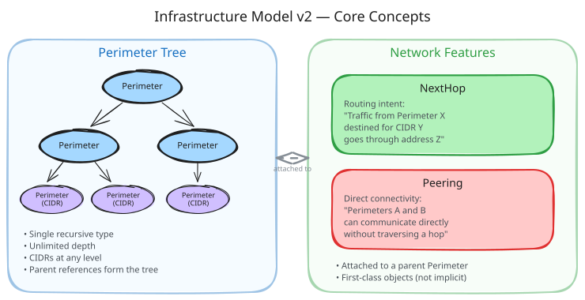
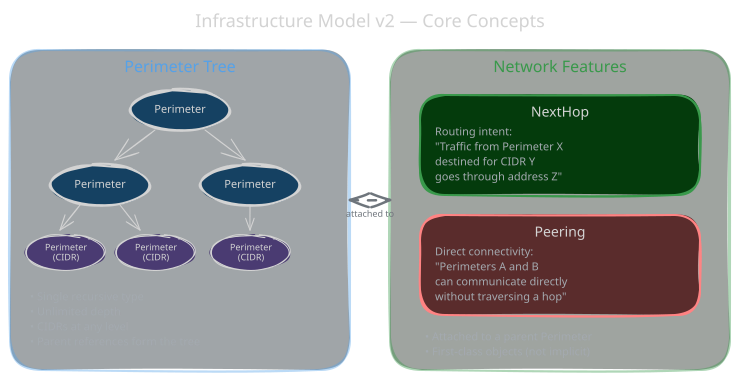
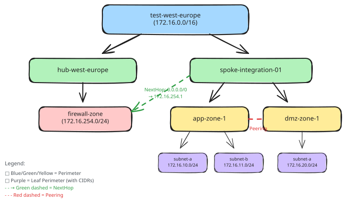
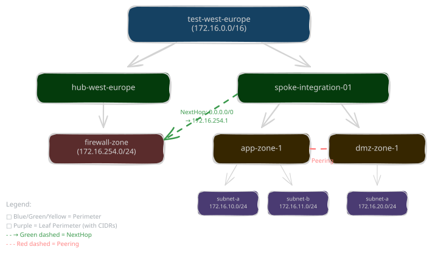

# Infrastructure Model v2

The Infrastructure Model v2 is the next generation of Yggy's network topology model. It replaces the fixed four-level hierarchy of v1 (Target → Landingzone → ZoneInstance → SubnetInstance) with a single, recursive building block: the **Perimeter**.

Combined with first-class **network feature** objects (NextHop, Peering), v2 enables teams to model arbitrary network topologies — from simple flat networks to complex hub-and-spoke architectures — without being constrained by a rigid structure.

!!! warning "Design, not shipped code"

    **None of this model is implemented in this release.** Perimeter, NextHop and
    Peering do not exist in the published codebase; the code in
    [`aud/`](https://github.com/AmadeusITGroup/Yggy/tree/main/aud) implements
    [Infrastructure Model v1](infrastructure-model-v1.md) only. This page is
    published as design documentation so the direction is public and reviewable —
    read it as a specification, not as an API you can call today.

!!! tip "Tip"

    If you're familiar with [Infrastructure Model v1](infrastructure-model-v1.md), the [Key Differences](#key-differences-from-v1) section below maps v1 concepts to their v2 equivalents.

## Key Differences from v1

| Aspect | v1 | v2 |
|--------|----|----|
| **Structure** | Fixed 4-level hierarchy (Target → Landingzone → ZoneInstance → SubnetInstance) | Recursive Perimeter tree (unlimited depth) |
| **Object types** | 4 distinct types with different schemas | 1 core type (Perimeter) composable at any level |
| **Network features** | Implicit (derived from zone types and firewall groups) | Explicit first-class objects (NextHop, Peering) |
| **CIDRs** | Only on SubnetInstance | On any Perimeter (leaf or intermediate) |
| **Extensibility** | None — fixed schema | Dynamic extensions via Schema registry |
| **API version** | `api_version: v1` | `apiVersion: v2` |
| **Identity** | `scope` + `name` | `domain` + `name` |

<div class="only-light" markdown>

</div>
<div class="only-dark" markdown>

</div>

??? info "Excalidraw Source"

    [:material-download: Download the Concepts diagram (Excalidraw)](../../assets/diagrams/infrastructure-model/infrastructure-model-v2-concepts.excalidraw)

---

## Perimeter

A **Perimeter** is the fundamental building block of the v2 infrastructure model. It represents a network boundary at any level of abstraction — from an entire cloud region down to a single isolation zone.

Perimeters form a **tree** through parent references. A perimeter with no parent is a root (e.g., a target-level grouping). A perimeter with a parent is a child that inherits the network context of its ancestor.

### Key Attributes

| Attribute | Description |
|-----------|-------------|
| `metadata.name` | Unique name within the domain |
| `metadata.domain` | Ownership domain (replaces v1's `scope`) |
| `metadata.labels` | Key-value pairs for selection and filtering |
| `spec.cidrs` | Optional list of CIDR blocks owned by this perimeter |
| `spec.parent` | Optional reference to a parent perimeter (`name` + `domain`) |

### How It Maps to v1

| v1 Concept | v2 Equivalent |
|------------|---------------|
| Target | Root Perimeter (no parent) |
| Landingzone | Child Perimeter of a Target-level perimeter |
| ZoneInstance | Child Perimeter of a Landingzone-level perimeter |
| SubnetInstance | Leaf Perimeter with CIDRs |

### YAML Examples

```yaml
# Root perimeter (equivalent to a v1 Target)
---
apiVersion: v2
kind: Perimeter
metadata:
  name: test-west-europe
  domain: Network
spec:
  cidrs:
    - 172.16.0.0/16

# Spoke perimeter (equivalent to a v1 Landingzone)
---
apiVersion: v2
kind: Perimeter
metadata:
  name: spoke-integration-01
  domain: Network
spec:
  parent:
    name: test-west-europe
    domain: Network

# Hub perimeter
---
apiVersion: v2
kind: Perimeter
metadata:
  name: hub-west-europe
  domain: Network
spec:
  parent:
    name: test-west-europe
    domain: Network

# Isolation zone (equivalent to a v1 ZoneInstance)
---
apiVersion: v2
kind: Perimeter
metadata:
  name: app-zone-1
  domain: Network
spec:
  parent:
    name: spoke-integration-01
    domain: Network

# Leaf perimeter with CIDRs (equivalent to a v1 SubnetInstance)
---
apiVersion: v2
kind: Perimeter
metadata:
  name: app-zone-1-subnet-a
  domain: Network
spec:
  cidrs:
    - 172.16.10.0/24
  parent:
    name: app-zone-1
    domain: Network
```

### Tree Structure

Perimeters form a tree that can be queried at any level:

```
test-west-europe (172.16.0.0/16)
├── hub-west-europe
│   └── firewall-zone (172.16.254.0/24)
└── spoke-integration-01
    ├── app-zone-1
    │   ├── app-zone-1-subnet-a (172.16.10.0/24)
    │   └── app-zone-1-subnet-b (172.16.11.0/24)
    └── dmz-zone-1
        └── dmz-zone-1-subnet-a (172.16.20.0/24)
```

---

## NextHop

A **NextHop** declares routing intent for a perimeter: "all traffic from this perimeter destined for a given CIDR should go through a specific next-hop address."

This is how you model firewall routing — traffic from a spoke is routed through a firewall appliance in the hub before reaching its destination.

### Key Attributes

| Attribute | Description |
|-----------|-------------|
| `metadata.name` | Identifier for this routing declaration |
| `metadata.domain` | Ownership domain |
| `spec.parent` | The perimeter whose traffic is being routed |
| `spec.nextHops` | List of routing entries, each with: |
| `spec.nextHops[].destination` | Destination CIDR (e.g., `0.0.0.0/0` for default route) |
| `spec.nextHops[].address.ip` | IP address of the next hop (e.g., firewall IP) |
| `spec.nextHops[].address.perimeter` | The perimeter where the next hop resides |

### YAML Example

```yaml
# All traffic from spoke-integration-01 routes through the firewall
---
apiVersion: v2
kind: NextHop
metadata:
  name: spoke-integration-01-default-route
  domain: Network
spec:
  parent:
    name: spoke-integration-01
    domain: Network
  nextHops:
    - destination: 0.0.0.0/0
      address:
        ip: 172.16.254.1
        perimeter:
          name: firewall-zone
          domain: Network
```

This declares that any traffic leaving `spoke-integration-01` with no more specific route should be forwarded to `172.16.254.1` (a firewall in `firewall-zone`).

### Multiple Next Hops

A perimeter can have multiple next-hop entries for different destinations:

```yaml
---
apiVersion: v2
kind: NextHop
metadata:
  name: spoke-integration-01-routes
  domain: Network
spec:
  parent:
    name: spoke-integration-01
    domain: Network
  nextHops:
    - destination: 0.0.0.0/0
      address:
        ip: 172.16.254.1
        perimeter:
          name: firewall-zone
          domain: Network
    - destination: 10.0.0.0/8
      address:
        ip: 172.16.254.2
        perimeter:
          name: firewall-zone
          domain: Network
```

---

## Peering

A **Peering** declares which perimeters can directly communicate with each other within the same parent context. Without a peering declaration, perimeters are isolated — traffic between them must go through a next hop (e.g., a firewall).

### Key Attributes

| Attribute | Description |
|-----------|-------------|
| `metadata.name` | Identifier for this peering declaration |
| `metadata.domain` | Ownership domain |
| `spec.parent` | The parent perimeter context for this peering |
| `spec.peers` | List of perimeters that can communicate directly |

### YAML Example

```yaml
# Allow direct communication between app-zone-1 and dmz-zone-1
---
apiVersion: v2
kind: Peering
metadata:
  name: spoke-integration-01-peering
  domain: Network
spec:
  parent:
    name: spoke-integration-01
    domain: Network
  peers:
    - name: app-zone-1
      domain: Network
    - name: dmz-zone-1
      domain: Network
```

This declares that `app-zone-1` and `dmz-zone-1` within `spoke-integration-01` can exchange traffic directly without traversing the hub firewall.

!!! note "Peering vs NextHop"

    - **Peering** = direct lateral connectivity between sibling perimeters (no intermediary).
    - **NextHop** = traffic must transit through a specific address (typically a firewall or router).

    If two perimeters are neither peered nor share a next-hop path, they are isolated from each other.

---

## Extensibility

The v2 model supports **dynamic schema extensions** that let teams create specialized perimeter types without modifying the core model. Extensions inherit from a base kind and add domain-specific attributes.

For example, an `IsolationZone` extension of `Perimeter` can add an `isolationLevel` attribute:

```yaml
---
apiVersion: v2
kind: Schema
metadata:
  name: IsolationZone
  extends: Perimeter
spec:
  schema:
    type: object
    properties:
      spec:
        type: object
        properties:
          isolationLevel:
            type: string
```

Once registered, instances of `IsolationZone` are created and queried like any perimeter, but carry additional metadata:

```yaml
---
apiVersion: v2
kind: IsolationZone
metadata:
  name: app-zone-1
  domain: Network
spec:
  isolationLevel: HIGH
  parent:
    name: spoke-integration-01
    domain: Network
```

Extensions are fully compatible with the base type — an `IsolationZone` appears in perimeter tree queries and can be referenced as a parent or peer like any other perimeter.

---

## End-to-End Example

Here is a complete scenario modeling a hub-and-spoke network topology with firewall routing:

**Scenario**: A test environment in West Europe with:

- A **hub** containing a firewall zone
- A **spoke** containing two isolation zones (app and dmz)
- Default routing through the firewall
- Direct peering between app and dmz zones within the spoke

```yaml
# =============================================================
# ROOT: Target-level perimeter
# =============================================================
---
apiVersion: v2
kind: Perimeter
metadata:
  name: test-west-europe
  domain: Network
spec:
  cidrs:
    - 172.16.0.0/16

# =============================================================
# HUB: Hub perimeter with firewall
# =============================================================
---
apiVersion: v2
kind: Perimeter
metadata:
  name: hub-west-europe
  domain: Network
spec:
  parent:
    name: test-west-europe
    domain: Network
---
apiVersion: v2
kind: Perimeter
metadata:
  name: firewall-zone
  domain: Network
spec:
  cidrs:
    - 172.16.254.0/24
  parent:
    name: hub-west-europe
    domain: Network

# =============================================================
# SPOKE: Spoke perimeter with isolation zones
# =============================================================
---
apiVersion: v2
kind: Perimeter
metadata:
  name: spoke-integration-01
  domain: Network
spec:
  parent:
    name: test-west-europe
    domain: Network

# --- App zone with leaf perimeters ---
---
apiVersion: v2
kind: Perimeter
metadata:
  name: app-zone-1
  domain: Network
spec:
  parent:
    name: spoke-integration-01
    domain: Network
---
apiVersion: v2
kind: Perimeter
metadata:
  name: app-zone-1-subnet-a
  domain: Network
spec:
  cidrs:
    - 172.16.10.0/24
  parent:
    name: app-zone-1
    domain: Network
---
apiVersion: v2
kind: Perimeter
metadata:
  name: app-zone-1-subnet-b
  domain: Network
spec:
  cidrs:
    - 172.16.11.0/24
  parent:
    name: app-zone-1
    domain: Network

# --- DMZ zone with leaf perimeter ---
---
apiVersion: v2
kind: Perimeter
metadata:
  name: dmz-zone-1
  domain: Network
spec:
  parent:
    name: spoke-integration-01
    domain: Network
---
apiVersion: v2
kind: Perimeter
metadata:
  name: dmz-zone-1-subnet-a
  domain: Network
spec:
  cidrs:
    - 172.16.20.0/24
  parent:
    name: dmz-zone-1
    domain: Network

# =============================================================
# NETWORK FEATURES
# =============================================================

# Default route: spoke traffic goes through firewall
---
apiVersion: v2
kind: NextHop
metadata:
  name: spoke-integration-01-default-route
  domain: Network
spec:
  parent:
    name: spoke-integration-01
    domain: Network
  nextHops:
    - destination: 0.0.0.0/0
      address:
        ip: 172.16.254.1
        perimeter:
          name: firewall-zone
          domain: Network

# Direct peering: app and dmz zones can talk directly
---
apiVersion: v2
kind: Peering
metadata:
  name: spoke-integration-01-internal-peering
  domain: Network
spec:
  parent:
    name: spoke-integration-01
    domain: Network
  peers:
    - name: app-zone-1
      domain: Network
    - name: dmz-zone-1
      domain: Network
```

### Resulting Topology

```
test-west-europe (172.16.0.0/16)
│
├── hub-west-europe
│   └── firewall-zone (172.16.254.0/24)
│         ↑
│         │ NextHop: 0.0.0.0/0 → 172.16.254.1
│         │
└── spoke-integration-01
    │
    ├── app-zone-1 ←─── Peering ───→ dmz-zone-1
    │   ├── app-zone-1-subnet-a (172.16.10.0/24)
    │   └── app-zone-1-subnet-b (172.16.11.0/24)
    │
    └── dmz-zone-1
        └── dmz-zone-1-subnet-a (172.16.20.0/24)
```

**Traffic flow**:

- Traffic between `app-zone-1` and `dmz-zone-1` flows **directly** (peered).
- Traffic from `spoke-integration-01` to any other destination routes through **172.16.254.1** (firewall in the hub).
- Traffic within a single perimeter (e.g., between `app-zone-1-subnet-a` and `app-zone-1-subnet-b`) flows freely — they share the same parent.

---

## Detailed Topology Diagram

<div class="only-light" markdown>

</div>
<div class="only-dark" markdown>

</div>

??? info "Excalidraw Source"

    [:material-download: Download the Topology diagram (Excalidraw)](../../assets/diagrams/infrastructure-model/infrastructure-model-v2.excalidraw)
