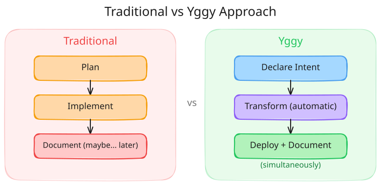
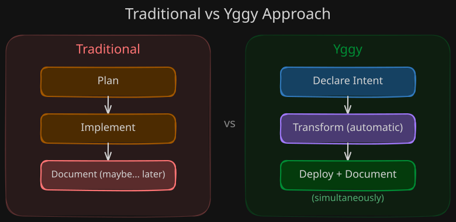

# Why Yggy?

This document explains the problem that Yggy solves and why a new approach to connectivity management is needed.

## The State of Networking Today

> *"A good way to think of the network layer is this: its job is to provide a best-efforts way to transport datagrams from source to destination, without regard to whether or not these machines are on the same network, or whether or not there are other networks in between them."*
>
> — Professor Andrew S. Tanenbaum (1996), *Computer Networks*

The network has always been about one thing: **connecting resources so data can flow between them**. But the way we manage that connectivity has become increasingly painful.

## The Problem

### Infrastructure Heterogeneity

Modern organizations run workloads across:

- **Multiple cloud platforms** — AWS, Azure, Google Cloud
- **Private data centers** — on-premises compute and storage
- **Edge locations** — CDNs, IoT gateways, branch offices
- **Container platforms** — Kubernetes, OpenShift

Each of these environments has its own **configurations, protocols, security policies, and tooling**. There is no unified model to reason about connectivity across them all.

### The Documentation Gap

Traditional network management follows a familiar cycle: **Plan → Implement → Document**.

The problem? **Documentation lags behind reality.** Configurations drift, changes are made without updating docs, and no one fully trusts the documentation to reflect the current state. This creates:

- **Inconsistency** — What is documented ≠ what is deployed
- **Audit risk** — Compliance cannot be verified against stale documentation
- **Slow recovery** — Rollbacks are guesswork when the source of truth is unreliable
- **Knowledge silos** — Only the person who made the change knows what happened

### Scaling Challenges

As infrastructure grows, the number of connectivity relationships grows **exponentially**. Managing VNets, subnets, NSGs, firewall rules, VPN tunnels, peerings, and routing policies across hundreds of environments with manual or semi-automated processes simply does not scale.

### Fragmented Tooling

Teams use different tools for different layers:

- Terraform for infrastructure provisioning
- Cloud-native consoles for network configuration
- Firewall management platforms for security policies
- Spreadsheets and wikis for documentation

Each tool has its own model, its own state, and its own version of the truth. There is no single pane of glass.

## The Yggy Approach

Yggy flips the traditional paradigm:

??? info "Excalidraw Source"

    [:material-download: Download the Traditional vs Yggy diagram (Excalidraw)](../assets/diagrams/overview/traditional-vs-yggy.excalidraw)

!!! quote "The Yggy Philosophy"

    **The descriptor IS the documentation. The documentation IS the action.**

Instead of configuring infrastructure and then documenting what was done, you **declare your connectivity intent** in a descriptor. Yggy's transformation pipeline reads these declarations and produces platform-specific configurations that are deployed to the target infrastructure. The descriptor is always up to date because it *is* the configuration.

### What Changes

| Traditional Approach | Yggy Approach |
|---------------------|---------------|
| Configure first, document later | Declare intent, everything follows |
| Platform-specific configurations | Platform-independent descriptors |
| Manual consistency checks | Automated governance and validation |
| Scattered documentation | Single source of truth |
| Point-in-time snapshots | Full version history with rollback |
| Siloed by infrastructure type | Unified model across all platforms |

## Core Innovation: The Abstract Connectivity Descriptor

The key innovation in Yggy is the **Abstract Connectivity Descriptor** — an abstract representation of network resources, configurations, policies, and intent that is independent of any specific infrastructure platform.

A descriptor captures:

- **Infrastructure Configuration** — IP ranges, subnets, VLANs, routing
- **Security Policies** — Guardrails, access control, VPN, encryption
- **Resource Attributes** — Compute, storage, network interfaces
- **Intent** — Performance targets, availability, quality of service

Using a Kubernetes-like declarative syntax, descriptors represent infrastructure and link it with application requirements and connectivity intent. Yggy then translates these abstract descriptors into concrete, platform-specific configurations for any target infrastructure.

??? info "Excalidraw Source"

    [:material-download: Download the Descriptor Model diagram (Excalidraw)](../assets/diagrams/overview/descriptor-model.excalidraw)

## Design Principles

### Declarative over Imperative

You describe *what* you want — not *how* to achieve it. This decouples intent from implementation, making the model portable across platforms and resilient to infrastructure changes.

### Distributed Control, Centralized Governance

Different teams (security SRE, infra SRE, network SRE, application SRE) each manage their own descriptors. Governance and validation are enforced centrally, but operational control is distributed to the teams that own each domain.

### Infrastructure Independence

The same descriptor model is designed to work across Azure, Google Cloud, Palo Alto, OVN, and any future provider. Adding a new platform means implementing a provider plugin — the core model and descriptors remain unchanged. This release ships one such plugin, for Azure network security groups; see [Core Concepts](concepts.md#infrastructure-types-managed).

### Full Auditability

Every change produces a new version. Versions are sealed (immutable) once finalized. This provides a complete audit trail and the ability to roll back to any previous state.

## Who is Yggy For?

| Role | How Yggy Helps |
|------|----------------|
| **Security SRE** | Define and enforce security policies, guardrails, and connectivity boundaries |
| **Infrastructure SRE** | Manage infrastructure configurations across clouds and data centers |
| **Network SRE** | Handle network topology, routing, and segmentation |
| **Application SRE** | Declare application connectivity intent without infrastructure knowledge |
| **Platform Engineers** | Integrate Yggy with Kratix, Humanitec, Backstage, and other platforms |
| **Automation Engineers** | Build end-to-end deployment pipelines with full traceability |

## Further Reading

- [Core Concepts](concepts.md) — Deep dive into descriptors, intent, topology
- [Architecture](../system-design/architecture.md) — How the system is built
- [Change Flow](../system-design/change-flow.md) — How changes move through the pipeline

